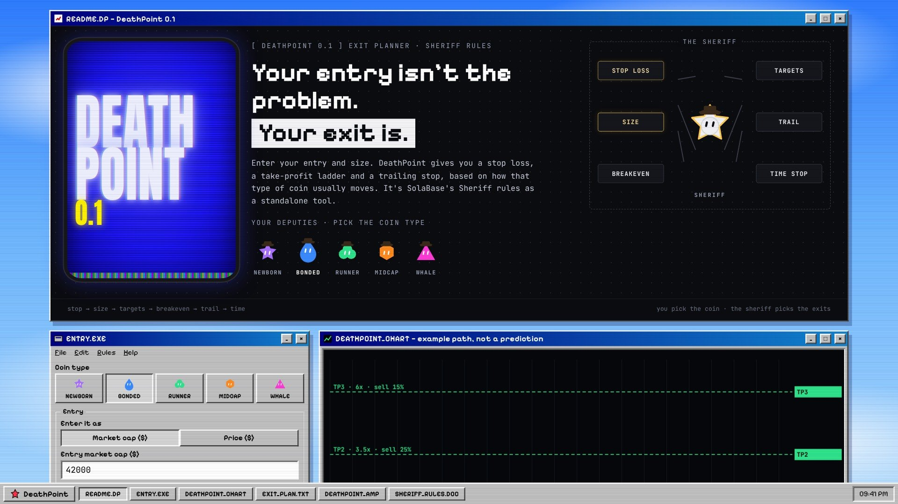
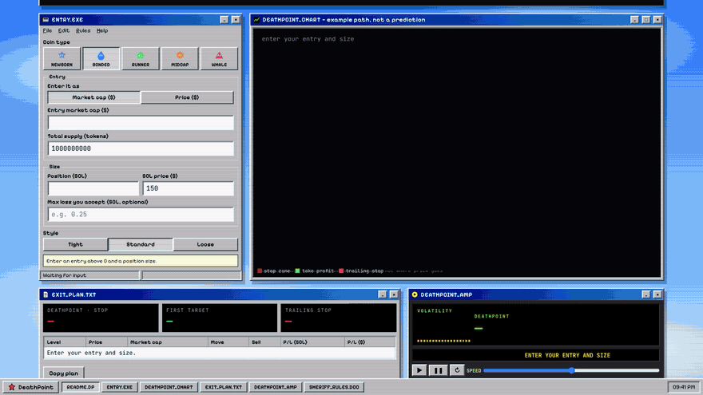
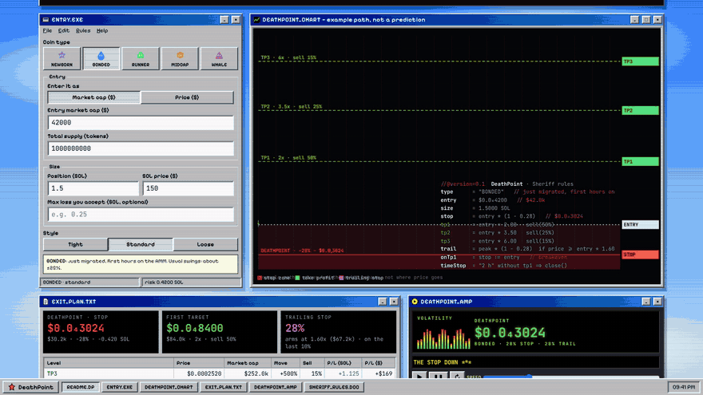
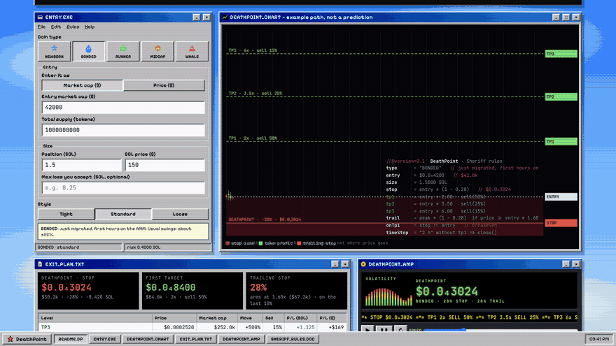
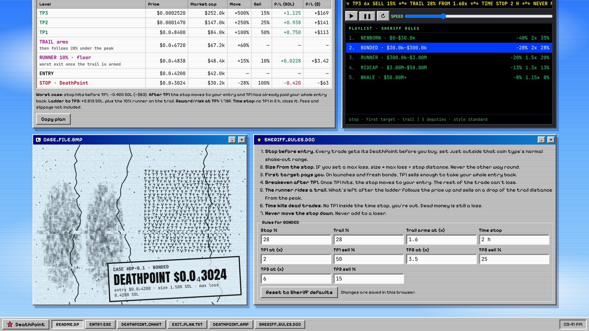

# DEATHPOINT 0.1

**Your entry isn't the problem. Your exit is.**

DeathPoint is an exit planner for Solana memecoins. You enter your **entry** and your **size**, pick the **coin type**, and it gives you a **stop loss**, a **take-profit ladder** and a **trailing stop**, all based on how that type of coin usually moves. It's SolaBase's Sheriff rules as a standalone tool.



**[Watch the video](docs/demo.mp4)** · [How to use it](#how-to-use-it) · [The rules](#the-rules) · [The logic](#the-logic) · [Why I built it](#why-i-built-it)

> No wallet connect, no keys, nothing to sign, no server. It's one HTML file that runs in your browser. It never trades for you: it just tells you where your exits are.

---

## How to use it

1. Download `index.html` (or clone the repo)
2. Open it in any browser. That's it, nothing to install
3. Enter your entry and your size, then pick the coin type

```bash
git clone https://github.com/0xF4ith/deathpoint.git
open deathpoint/index.html        # macOS
xdg-open deathpoint/index.html    # Linux
start deathpoint/index.html       # Windows
```

Everything you type is saved in your browser, so the next time you open it your last plan and your edited rules are still there. Nothing leaves your machine.

## See it work

| | |
|---|---|
|  |  |
| **ENTRY.EXE.** Enter the entry as a market cap or a price, then your size in SOL. You can also give it a max loss instead, and it sizes the position for you. | **Coin types.** Each type gets its own stop, ladder and trail. Switch types and the whole plan changes at once. |
|  |  |
| **DEATHPOINT_CHART.** An example path that shows the plan playing out: the stop, TP1, TP2, TP3, then the trail. It's an example, not a prediction. | **EXIT_PLAN.TXT.** Every level with its price, market cap, move, % sold and P/L in SOL and $. |

| | |
|---|---|
|  |  |

## The windows

| Window | What it does |
|---|---|
| **README.DP** | the intro and your deputies (the five coin types) |
| **ENTRY.EXE** | entry (market cap or price), supply, size, SOL price, optional max loss, and style: tight, standard or loose |
| **DEATHPOINT_CHART** | the levels drawn on an example price path, with the plan as code in the corner |
| **EXIT_PLAN.TXT** | stop, first target and trailing stop up top, then the full ladder with P/L |
| **DEATHPOINT_AMP** | the plan in one line, and a playlist of every coin type's rules |
| **CASE_FILE.BMP** | the case file for your coin |
| **SHERIFF_RULES.DOC** | the rules, written out. You can edit every number, and reset to the defaults |

## The rules

Each coin type moves differently, so each one gets its own numbers. A newborn can swing 35% without meaning anything. On a whale, a 35% drop means something is broken.

| Type | What it is | Market cap | Usual swing | Stop | TP1 | TP2 | TP3 | Trail arms | Trail | Time stop |
|---|---|---|---|---|---|---|---|---|---|---|
| **NEWBORN** | fresh launch, still on the bonding curve | under $30k | ±35% | -40% | 2x · 50% | 4x · 25% | 8x · 15% | 2x | 35% | 20 min |
| **BONDED** | just migrated, first hours on the AMM | $30k–$300k | ±25% | -28% | 2x · 50% | 3.5x · 25% | 6x · 15% | 1.6x | 28% | 2 h |
| **RUNNER** | small cap with real volume | $300k–$3M | ±18% | -20% | 1.5x · 35% | 2.5x · 30% | 4x · 20% | 1.4x | 20% | 12 h |
| **MIDCAP** | established coin, days to weeks old | $3M–$50M | ±12% | -13% | 1.3x · 30% | 1.7x · 30% | 2.5x · 20% | 1.25x | 13% | 3 days |
| **WHALE** | large cap memes, deep liquidity | $50M+ | ±7% | -8% | 1.15x · 30% | 1.35x · 30% | 1.7x · 20% | 1.12x | 8% | 2 weeks |

The TP percentages are shares of your **first** bag. Whatever the ladder doesn't sell (10% to 30% of the bag) is the runner, which rides the trail.

**Style** scales the stop and the trail: **tight** ×0.75, **standard** ×1, **loose** ×1.3.

### The four laws

1. **TP1 hits, the stop moves to your entry.** From there the trade can't lose
2. **What's left follows the price.** It falls a set % from the peak, it's sold
3. **TP1 doesn't come in time, the trade is ended.** That's the time stop. No bagholding a coin that died
4. **The DeathPoint never moves down.** You can raise a stop. You never lower one

These numbers are my version of the Sheriff rules, written for this tool. They're defaults, not gospel: change any of them in SHERIFF_RULES.DOC.

## The logic

Everything is plain math on your inputs, and it runs in your browser:

```
entry price  = entry market cap / supply       (or the price you typed)
stop         = entry × (1 − stop% × style)     ← the DeathPoint
TPn          = entry × multiple                 sells n% of the first bag
trail arms   = entry × arm multiple
trail        = peak × (1 − trail% × style)     only ever moves up
on TP1       = stop := entry                    breakeven
time stop    = no TP1 within the time limit → close
```

- **Max loss sizing:** if you fill in the max loss you accept, it works backwards: `size = max loss / stop%`. Your stop never costs you more than that number
- **Risk at TP1:** it shows what TP1 pays back compared with what the stop risks, so you see if the trade is even worth taking
- **Type hint:** if your market cap looks like another type (say you picked WHALE at $40k), it tells you
- **DEX prices:** tiny prices are written like DEX screens write them: `$0.0₄3024` means four zeros after the dot

## Why I built it

Everyone talks about the entry. The entry is the easy part: you see a chart, you buy.

The exit is where the money goes. You're up 4x, you don't sell because it "could go 10x", it rugs to -30%, and now you're holding a bag you never planned for. The fix isn't a better entry. It's deciding the exit **before** you buy, while you can still think.

That's all DeathPoint does. Write the entry and the coin dies on your terms, not the chart's.

## Notes

- It's an exit **planner**. It doesn't connect to a wallet and it doesn't place orders. You set the levels in your terminal (Axiom, Photon, whatever you use)
- The chart is an example path to show the levels working. It's not a prediction of what your coin will do
- Not financial advice. Memecoins can go to zero in one candle, and no stop is guaranteed to fill at its price

## License

MIT
